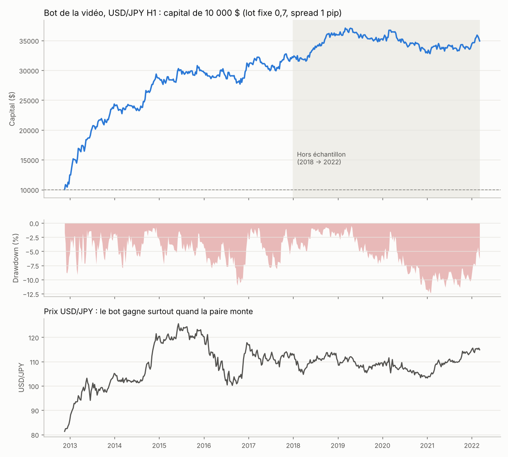

# Bot de trading de la vidéo, refait avec Claude Code (version MT5)

Vidéo source : « Il crée un bot de trading rentable avec ChatGPT (les résultats sont fous) », chaîne Impact Trading, publiée le 18/01/2026 (https://youtu.be/TgBTvfAzs1s).

## 1. La stratégie de la vidéo, règle par règle

| Règle dite dans la vidéo | Dans le bot |
|---|---|
| USD/JPY, unité de temps H1 | `InpTimeframe = PERIOD_H1`, prévu pour USDJPY |
| Croisement de 2 moyennes mobiles : la rapide « collée au prix » passe au-dessus de la lente « lissée » → achat | `BuySignal()` sur les bougies clôturées |
| Achat uniquement, jamais de contre-tendance | aucune vente dans le code |
| Stop loss 55 pips | `InpStopLossPips = 55` |
| Trailing stop 55 pips, qui démarre au même niveau que le stop loss (pas de break-even à zéro) | `InpTrailingPips = 55` |
| Une seule position ouverte, on attend le signal suivant | `HasOpenPosition()` |
| Stratégie évaluée seulement à l'ouverture d'une nouvelle bougie, jamais à chaque tick | `IsNewBar()` |
| Contrôle du spread (max 30), glissement | `InpMaxSpreadPoints = 30`, `InpSlippagePoints` |
| Pas d'entrée entre 23 h et 1 h | `InpNoTradeFromHour = 23`, `InpNoTradeToHour = 1` |
| Lot fixe 0,7 pour 10 000 de capital, ou lot auto qui suit le capital | `InpFixedLot`, `InpAutoLot`, `InpLotPer10k` |
| Nom affiché, numéro magique unique, journal des erreurs | `InpBotName`, `InpMagic`, `Log()` / `LogError()` |
| Pas de grid, pas de martingale | respecté |

**Ce que la vidéo ne dit pas :** les périodes exactes des deux moyennes mobiles. Léo dit que c'est « l'élément clé » mais ne donne pas les chiffres (il les garde pour son algo « offert » contre inscription). J'ai donc testé 126 combinaisons (voir section 4) et mis par défaut **EMA 8 / SMMA 30**, une des meilleures sur 2012-2017 et l'une des plus stables ensuite. Tu peux les changer dans les paramètres.

**Ajout de sécurité :** le robot refuse de tourner sur un compte réel tant que `InpAllowRealAccount = false`.

## 2. Les fichiers

- `MA_Cross_USDJPY.mq5` : l'Expert Advisor MetaTrader 5.
- `backtest.py` : le même algorithme en Python, pour le backtest sur 10 ans.
- `data/USDJPYh1.csv` : bougies H1 USD/JPY de nov. 2012 à mars 2022 (source : dépôt public ejtraderlabs/historical-data).
- `results/` : courbe de capital, liste des trades, grille de test des paramètres.

## 3. Installer et tester dans MetaTrader 5 (compte démo)

1. Ouvre MT5, connecte-toi à un **compte démo** (Fichier → Ouvrir un compte → démo).
2. Fichier → Ouvrir le dossier des données → `MQL5/Experts` : copie `MA_Cross_USDJPY.mq5` dedans.
3. Ouvre MetaEditor (F4), ouvre le fichier, clique sur **Compiler** (F7). Il doit afficher 0 erreur. Je n'ai pas MetaEditor ici, donc si une erreur sort, envoie-moi le message et je corrige.
4. Dans MT5, Navigateur → Expert Advisors → clic droit « Actualiser ». Glisse le robot sur un graphique **USDJPY H1**, active le bouton **Algo Trading**.
5. Backtest dans MT5 : Affichage → Testeur de stratégie (Ctrl+R), USDJPY, H1, modèle « Chaque tick basé sur des ticks réels », de 2012 à aujourd'hui, dépôt 10 000. Ça couvre 2022-2026 que je n'ai pas pu télécharger ici.
6. Le conseil de Léo, qui est bon : laisse tourner 3 mois en démo, puis relance le testeur sur ces 3 mois. Si les résultats sont proches, le backtest est fiable chez ton broker.

## 4. Mes résultats de backtest (Python, USD/JPY H1, nov. 2012 → mars 2022)

Hypothèses : capital 10 000 $, lot fixe 0,7 (comme la vidéo), spread 1 pip + glissement 0,3 pip, swaps et commissions non comptés.

| | Résultat |
|---|---|
| Gain total | +249 % (10 000 → 34 900 $) |
| Rendement annuel moyen | 14,4 % |
| Pire baisse (drawdown) | −12,4 % (mais −31 % si on démarre à 10 000 $ en 2018) |
| Trades | 532, dont 43 % gagnants |
| Profit factor | 1,39 |
| Plus longue période sans nouveau record | 1 045 jours (près de 3 ans) |

Par année : 2012 +24,6 % · 2013 **+95 %** · 2014 +18,2 % · 2015 +3,1 % · 2016 +3,4 % · 2017 +5 % · 2018 +11,8 % · 2019 **−2,4 %** · 2020 **−6,2 %** · 2021 +4,8 %.

## 5. Ce qui est vrai et ce qui est douteux dans la vidéo

**Vrai :**
- La logique est saine : stop loss sur chaque trade, pas de martingale, pas de grid. C'est bien mieux que 90 % des bots vendus en ligne.
- Le conseil « démo 3 mois puis comparer au backtest » est le bon réflexe.

**Douteux ou faux, chiffres à l'appui :**
1. **« Chaque année, du 3 janvier au 31 décembre, tu fais de la rentabilité, c'est sûr. »** Faux dans mon test : 2019 et 2020 sont négatives.
2. **« Depuis 2012 on est en hausse, inutile de backtester avant. »** C'est l'aveu du problème. USD/JPY est passé d'environ 124 en 2007 à environ 76 fin 2011 : un bot qui ne fait qu'acheter aurait perdu. Choisir de commencer le test en 2012, c'est choisir la période qui arrange.
3. **Le gain vient surtout de la hausse du dollar, pas du croisement de moyennes.** J'ai remplacé le signal par des achats **au hasard** avec le même stop et le même trailing : 92 % des 200 essais sont gagnants (+113 % en médiane), contre +139 % en médiane pour les 126 réglages de moyennes. Le croisement apporte un petit plus, mais l'essentiel, c'est « être acheteur sur une paire qui monte ». Même stratégie sur EUR/USD, qui a baissé sur la période : à peu près zéro (profit factor 0,96 à 1,06).
4. **Le réglage optimal ne se prolonge pas.** Entre la performance d'un réglage sur 2012-2017 et sur 2018-2022, la corrélation est de −0,1 : le meilleur réglage d'hier n'est pas le meilleur demain. Sur 2018-2022, le réglage par défaut fait +23 % en 4 ans, avec −31 % de drawdown.
5. **« +36 % en live depuis le 27 mai 2025. »** Pas vérifiable (aucun relevé Myfxbook montré). C'est cohérent avec le marché : USD/JPY est passé d'environ 144 fin mai 2025 à environ 155-159 en janvier 2026 (Yahoo Finance). Un bot acheteur en profite mécaniquement. Depuis la vidéo, USD/JPY tourne entre 152 et 164 (157,5 le 30/10/2026), donc un marché plat, la phase où ce bot gagne peu.
6. **Le risque est élevé :** 0,7 lot pour 10 000 avec un stop de 55 pips, ça fait environ 245 $ à 350 $ de perte par trade selon le cours, soit 2,5 à 3,5 % du capital. Pour viser environ 1 %, mets plutôt 0,3 lot pour 10 000 au cours actuel.
7. **La vidéo est un tunnel de vente :** algo « offert » contre inscription, coaching, Telegram, lien affilié de prop firm avec code promo. Ça ne rend pas tout faux, mais les chiffres sont présentés pour vendre.

## 6. Limites de mon test

- Mes données H1 s'arrêtent en mars 2022 : depuis cet environnement, je n'ai pas pu télécharger 2022-2026 en H1. Le testeur MT5 (étape 5) comble ce trou avec les données de ton broker.
- En H1, on ne connaît pas l'ordre exact haut/bas dans la bougie : j'ai pris une hypothèse prudente. Le testeur MT5 « ticks réels » est plus précis.
- Swaps non comptés : sur USD/JPY, un achat touche souvent un swap positif, ce qui aiderait un peu, mais ça dépend du broker.
